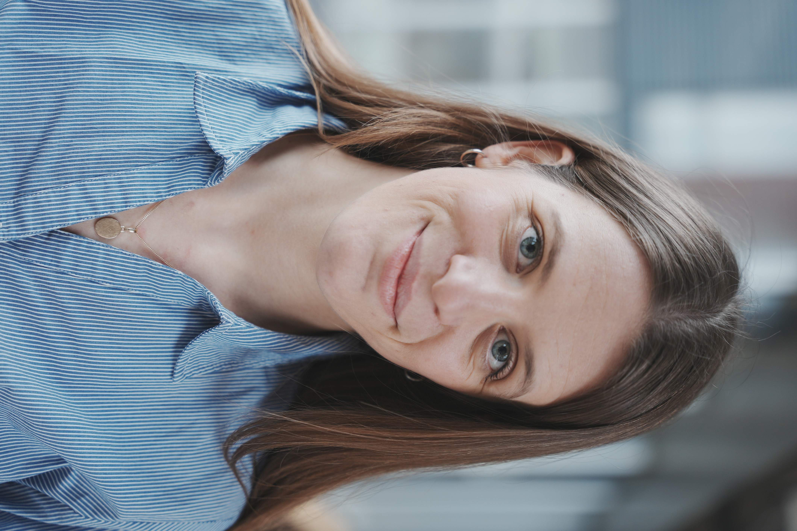

:::: {.columns}

::: {.column width="60%"}

# PhD Researcher in Microbial Water Quality & Data Science

I am an industrial PhD researcher at Lund University and Sweden Water Research. My research focuses on microbial water quality monitoring and the application of data-driven methods to better understand and predict changes in water quality.

My work combines online monitoring, flow cytometry, environmental data, and machine learning, with a particular interest in translating these approaches into practical tools for water utilities.

**Lund University · Sweden Water Research**

[Google Scholar](https://scholar.google.com/citations?user=z3tJCY8AAAAJ&hl=de&oi=ao) · [ORCID](https://orcid.org/0009-0001-5161-2336) · [GitHub](https://github.com/isabel-erb) · [LinkedIn](https://www.linkedin.com/in/isabel-erb-2875a820b/)

:::

::: {.column width="40%"}

{width=240px}

:::

::::

::: {.water-animation}

::: {.microbe .microbe-1}
:::

::: {.microbe .microbe-2}
:::

::: {.microbe .microbe-3}
:::

::: {.microbe .microbe-4}
:::

::: {.microbe .microbe-5}
:::

::: {.microbe .microbe-6}
::: {.microbe .microbe-7}
:::

::: {.microbe .microbe-8}
:::

::: {.microbe .microbe-9}
:::

::: {.microbe .microbe-10}
:::

::: {.microbe .microbe-11}
:::

::: {.microbe .microbe-12}
:::

::: {.microbe .microbe-13}
:::

::: {.microbe .microbe-14}
:::

:::

::: {.wave .wave-1}
:::

::: {.wave .wave-2}
:::

:::